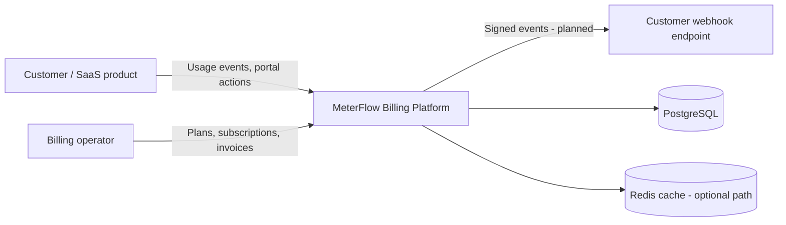
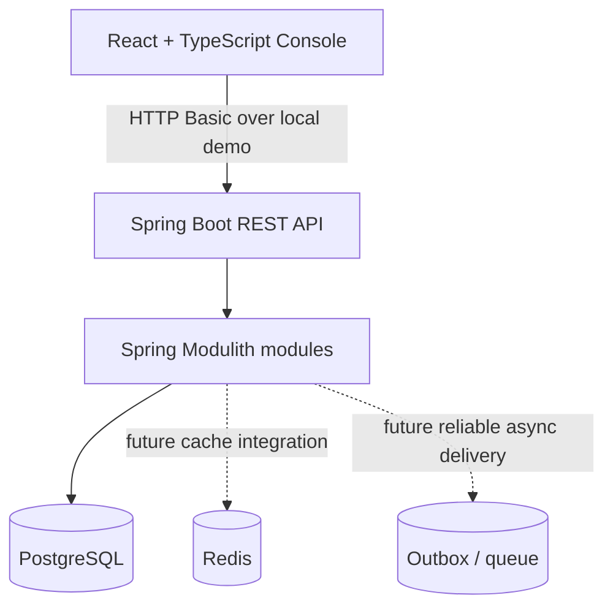
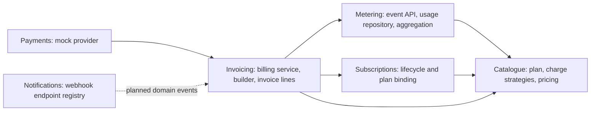

# C4 architecture views

## Context

## Container view

## Component/module view

## Deployment view
Docker Compose runs frontend, backend, PostgreSQL and Redis for local development. Validate actual container health and resource usage on the target machine before claiming the 8 GB deployment constraint.

## Key boundaries and constraints
- Money is represented using `BigDecimal`; do not use binary floating point for billing.
- Usage windows should be half-open `[from, to)` to avoid boundary double counting.
- The usage idempotency key has a database uniqueness constraint; application pre-checks alone are not sufficient under concurrency.
- Current security is a local academic HTTP Basic demo. Customer ownership enforcement and production authentication are still required.
